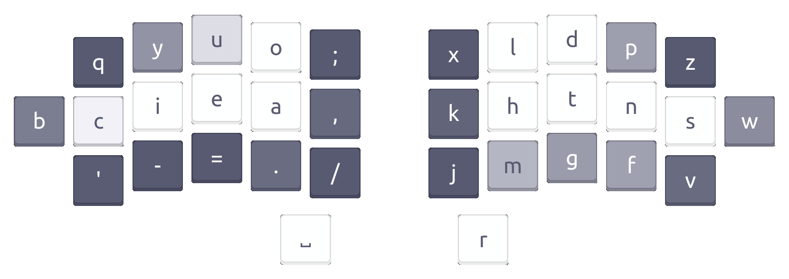
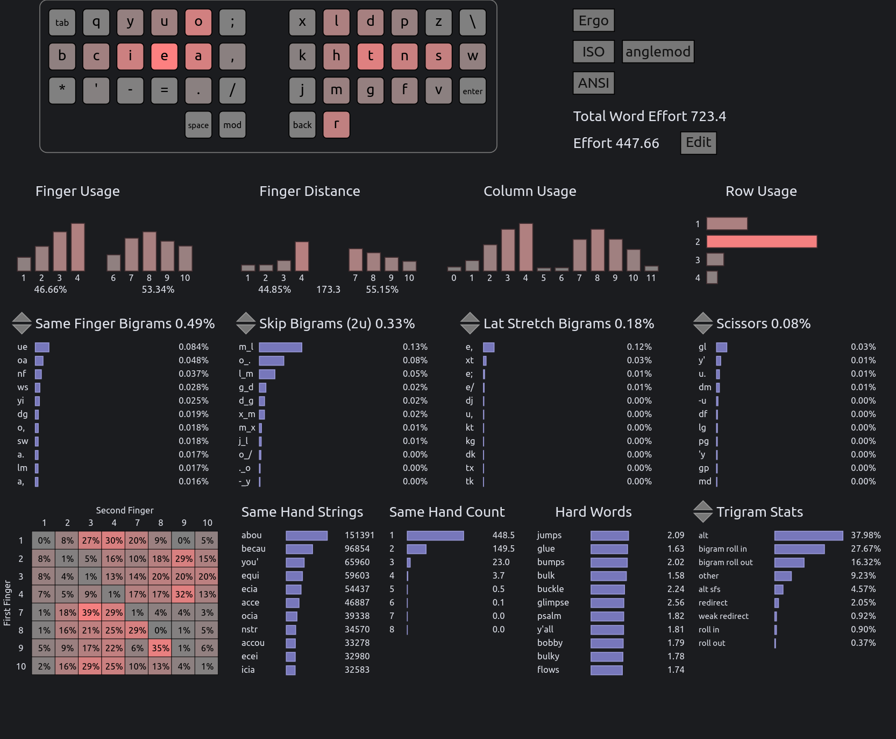
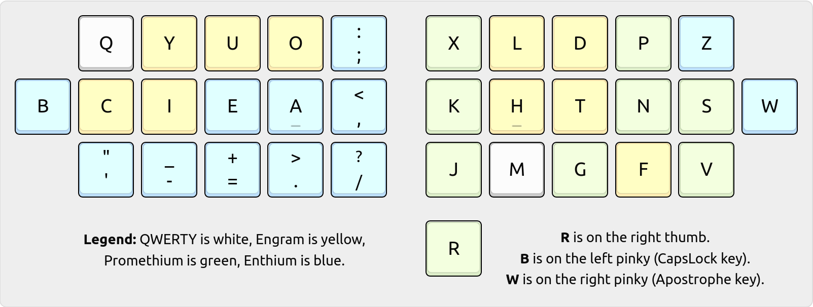
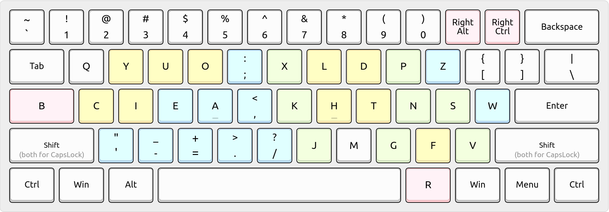
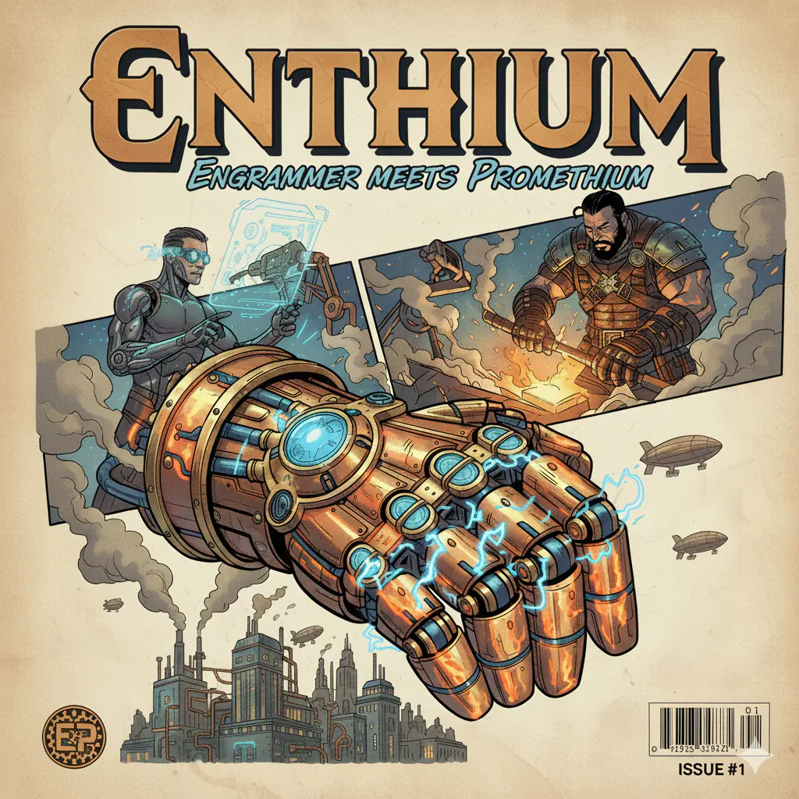

# Enthium v15 - Engrammer meets Promethium

*Enthium* is a highly performant thumb-letter keyboard layout derived from
[Engrammer] and [Hands Down Promethium] that commemorates [Arno's Engram 2.0]
and [Dvorak] with CIEA and HTNS on the home row, respectively, while optimizing
punctuation and symbol placement for programming and application shortcuts,
including HJKL for Vim navigation, `-=` for zooming, and `./` for file paths.

      q y u o ; x l d p z
    b c i e a , k h t n s w
      ' - = . / j m g f v
                r

[Hands Down Promethium]: https://reddit.com/r/KeyboardLayouts/comments/1g66ivi
[Arno's Engram 2.0]:     https://github.com/binarybottle/engram-2021
[Engrammer]:             https://github.com/sunaku/engrammer
[Dvorak]:                https://www.dvzine.org

## Rationale

Enthium balances layout analyzer metrics (same-finger use, lateral stretches,
redirects, rolls, pinky load, etc.) with findings from my extensive real-world
evaluation plus feedback from early adopters in the Glove80 keyboard community.

* Pinky load is stratified by frequency: heavy letters B (1.44%) and W (1.77%)
  are close to the home position on lateral pinky keys (CapsLock, Apostrophe);
  Apostrophe `'` (0.47%) and letter V (1.09%) occupy the lower row pinky keys;
  and light letters Q (0.10%) and Z (0.09%) sit on the upper row.  This helps
  reduce strain for pinky fingers that are short or [weakened by convention].

* Apostrophe is on a different finger from vowels to avoid same-finger bigrams
  when typing English contractions like I'm, I've, it's, you're, don't, we'd.

* Vertical same-finger bigrams such as UE (0.08%), OA (0.05%), and NF (0.04%)
  can be _raked down_, which can help reduce interruptions to your typing flow.
  Similarly, horizontal ones can be _slid over_ based on dexterity and comfort.

* Cross-hand symmetry (EA and TH roll inward, whereas OU and LD roll outward)
  provides consistent directional patterns across vowel and consonant clusters,
  while E on the middle finger supports continuity through vowel-heavy words.

* QU is an inward roll that continues smoothly into common vowel sequences:
  QUO keeps rolling inward, QUI/QUA roll downward, and QUE rakes downward.

* `.` and `/` are clustered for relative file paths such as `./` and `../`.

* `-` and `=` are clustered for intuitive zoom-in/out shortcuts with Ctrl.

* Ctrl-B/I/U shortcuts for bold/italic/underline are all on the same hand.

* B/E/W, I/A, K/J, Ctrl-P/N, and T/F physically align with Vim directions.

* `;` and `,` are stacked for cycling through f/F/t/T jump targets in Vim,
  mirroring the relative ordering of L and H for horizontal Vim navigation.

* Although `.` and `,` swap the QWERTY positions of their shifted symbols (`>`
  and `<`), this arrangement reduces lateral stretching by clustering `>` with
  `-` and `=` for `->` and `=>` arrows, respectively, as well as stacking `.`
  above `,` to be vertically rakeable on conventional row-staggered keyboards.

See [my blog post] for deeper exposition of Enthium's design and evolution.

[my blog post]:           https://sunaku.github.io/enthium-keyboard-layout.html
[weakened by convention]: https://reddit.com/r/KeyboardLayouts/comments/1fy8nve/_/lqulnww/

## Performance

The [keyboard layouts community][rKL] often recommends [Pascal Getreuer's
guide][PGr] and ranking tables as a starting point for choosing a layout,
and Enthium ranks among the top-performing layouts there as of 2026-08-16:

| Metric        | SFBs   | LSBs   | Scissors | Rolls  | Redirects | Pinky use |
| ------------- | ------ | ------ | -------- | ------ | --------- | --------- |
| **Score**     | 0.49%  | 0.18%  | 0.08%    | 45.26% | 2.05%     | 14.44%    |
| **Rank**\<1\> | 3rd 🥉 | 2nd 🥈 | 1st 🥇   | 8th    | 5th       | 4th       |
| **Rank**\<2\> | 1st 🥇 | 1st 🥇 | 1st 🥇   | 16th   | 8th       | 4th       |

1. Compared to other [thumb-letter layouts][PGt] excluding past versions of Enthium.
2. Compared to non-thumb [conventional layouts][PGl], such as QWERTY and Dvorak.

These performance scores were [computed using Cyanophage's Layout Analyzer][cNM]:

[][cNM]

Many same-finger bigrams (SFBs) in Enthium can also be _raked down_ vertically
across adjacent rows or _slid over_ laterally, depending on your dexterity and
comfort.  These techniques let the same finger actuate both keys in a single,
continuous motion, which can help reduce interruptions to your typing rhythm.
For example, the word *queue* can be typed as a Q tap followed by two UE rakes.

* Rakeable SFBs (0.228%) =
           `ue` (0.084%) +
           `oa` (0.048%) +
           `nf` (0.037%) +
           `yi` (0.025%) +
           `a.` (0.017%) +
           `hm` (0.005%) +
           `dt` (0.004%) +
           `tg` (0.002%) +
           `c'` (0.002%) +
           `sv` (0.002%) +
           `pn` (0.001%) +
           `lh` (0.001%)

* Slideable SFBs (0.092%) =
            `ws` (0.028%) +
            `sw` (0.018%) +
            `a,` (0.016%) +
            `lk` (0.016%) +
            `xh` (0.003%) +
            `bc` (0.003%) +
            `kh` (0.003%) +
            `o;` (0.002%) +
            `km` (0.001%) +
            `cb` (0.001%) +
            `a/` (0.001%)

[cNM]: https://cyanophage.github.io/playground.html?layout=qyuo%3Bxldpz%5Cciea%2Ckhtnsw%27-%3D.%2Fjmgfv*rb&mode=ergo&lan=english&thumb=r
[cPM]: https://cyanophage.github.io/playground.html?layout=fpdlx%3Buoybzsnthk%2Caeicqvwgmj-.%27%3D%2F%5Cr&mode=ergo&lan=english&thumb=l
[cNG]: https://cyanophage.github.io/playground.html?layout=byou%27%3Bldwvzciea%2C.htsnqgxjk-%2Frmfp%5C%5E&mode=ergo&lan=english&thumb=l
[cDV]: https://cyanophage.github.io/playground.html?layout=%27%2C.pyfgcrl%2Faoeuidhtns-%3Bqjkxbmwvz%5C%5E&mode=ergo&lan=english&thumb=l
[cCD]: https://cyanophage.github.io/playground.html?layout=qwfpbjluy%3B-arstgmneio%27zxcdvkh%2C.%2F%5C%5E&mode=ergo&lan=english&thumb=l
[cQW]: https://cyanophage.github.io/playground.html?layout=qwertyuiop-asdfghjkl%3B%27zxcvbnm%2C.%2F%5C%5E&mode=ergo&lan=english&thumb=l

| Category | Metric                 | [Enthium][cNM] | [Promethium][cPM] | [Engrammer][cNG] | [Dvorak][cDV] | [Colemak-DH][cCD] | [QWERTY][cQW] |
| -------- | ---------------------- | -------------- | ----------------- | ---------------- | ------------- | ----------------- | ------------- |
| Summary  | 📉 Total Word Effort   | 723.4          | 732.1             | 899.5            | 1185.5        | 1047.9            | 2070.6        |
| Summary  | 📉 Effort              | 447.66         | 398.09            | 457.41           | 769.69        | 534.99            | 1258.15       |
| Bigrams  | 📉 Same Finger Bigrams | 0.49%          | 0.58%             | 0.99%            | 1.87%         | 0.91%             | 4.38%         |
| Bigrams  | 📉 Skip Bigrams (2u)   | 0.33%          | 0.36%             | 0.39%            | 0.45%         | 0.49%             | 1.43%         |
| Bigrams  | 📉 Skip Bigrams (SFS)  | 2.73%          | 3.05%             | 3.47%            | 3.48%         | 4.24%             | 5.45%         |
| Bigrams  | 📉 Lat Stretch Bigrams | 0.18%          | 0.24%             | 0.41%            | 0.80%         | 1.27%             | 4.55%         |
| Bigrams  | 📉 Scissors            | 0.08%          | 0.11%             | 0.36%            | 0.08%         | 0.15%             | 1.46%         |
| Trigrams | 📈 Alt                 | 37.98%         | 36.98%            | 35.62%           | 39.08%        | 25.43%            | 21.38%        |
| Trigrams | 📉 Alt SFS             | 4.57%          | 5.27%             | 5.93%            | 5.85%         | 5.47%             | 5.42%         |
| Trigrams | 📈 Roll in             | 0.90%          | 1.72%             | 1.82%            | 0.28%         | 1.50%             | 1.32%         |
| Trigrams | 📈 Roll out            | 0.37%          | 0.29%             | 0.29%            | 0.27%         | 0.98%             | 1.48%         |
| Trigrams | 📈 Bigram roll in      | 27.67%         | 29.17%            | 28.14%           | 23.51%        | 25.18%            | 20.38%        |
| Trigrams | 📈 Bigram roll out     | 16.32%         | 14.56%            | 14.03%           | 15.14%        | 21.54%            | 17.58%        |
| Trigrams | 📉 Redirect            | 2.05%          | 1.53%             | 2.26%            | 1.55%         | 5.33%             | 6.22%         |
| Trigrams | 📉 Weak redirect       | 0.92%          | 0.87%             | 0.74%            | 0.64%         | 1.09%             | 0.44%         |
| Trigrams | 📉 Other               | 9.23%          | 9.61%             | 11.17%           | 13.68%        | 13.49%            | 25.78%        |
| Computed | 📉 Pinky use           | 14.44%         | 14.41%            | 16.86%           | 19.32%        | 16.58%            | 11.04%        |

* Legend: 📉 means lower is better, whereas 📈 means higher is better.

[rKL]: https://www.reddit.com/r/KeyboardLayouts/
[PGr]: https://getreuer.info/posts/keyboards/alt-layouts/
[PGl]: https://getreuer.info/posts/keyboards/alt-layouts/#which-alt-keyboard-layout-should-i-learn
[PGt]: https://getreuer.info/posts/keyboards/alt-layouts/#layouts-with-thumb-keys

## Implementation

* Letter R is placed on a right thumb key at the thumb's resting position.
* Letter B is placed on a left pinky key at the immediate left of letter C.
* Letter W is placed on a right pinky key at the immediate right of letter S.

### Row-staggered keyboards

* Letter R is placed on the key at the immediate right of Spacebar.
* Letter B is placed on the key at the immediate left of letter C.
* AltGr is placed on the key at the immediate right of digit 0.
* Ctrl is placed on the key at the immediate left of Backspace.

### Split/columnar keyboards

See my [Glorious Engrammer] keymap:

[Glorious Engrammer]: https://github.com/sunaku/glove80-keymaps

## Installation

Run each block of commands from this repository's root directory.

### Kanata setup

Use the provided `kanata.kbd` keymap file with [Kanata] directly:

    kanata -c kanata.kbd

You can also choose to install that into your account, like this:

    mkdir -p ~/.config/kanata/
    cp -i kanata.kbd ~/.config/kanata/

Refer to [Kanata]'s documentation for further usage instructions.

[Kanata]: https://github.com/jtroo/kanata

### Linux setup

Install:

    cd linux/
    sudo make install
    echo Now restart your graphical session.

Activate (tap both Shifts together for CapsLock; Win+Space for QWERTY toggle):

    setxkbmap -layout us,us -variant enthium,basic -option grp:shifts_toggle -option grp:win_space_toggle

Repair (e.g. whenever a system-wide XKB package upgrade reverts installation):

    cd linux/
    sudo make reinstall
    echo Now restart your graphical session.

Uninstall:

    cd linux/
    sudo make uninstall
    echo Now restart your graphical session.

### macOS setup

Install:

* You'll need [Karabiner-Elements], which is also available in [Homebrew]:

      brew install --cask karabiner-elements

Activate:

* Use the [complex modification feature for Enthium][KeNM] to remap your keys.

  (Note: The latest version of this is [available here in this Git repository](macos/karabiner.json).)

Uninstall:

* Remove the complex modification feature for Enthium that you activated.

* Optionally remove Karabiner-Elements, which can be done with Homebrew:

      brew uninstall --cask karabiner-elements

[KeNM]: https://ke-complex-modifications.pqrs.org/?q=enthium
[Karabiner-Elements]: https://karabiner-elements.pqrs.org
[Homebrew]: https://brew.sh

## License

[Spare A Life]: https://sunaku.github.io/vegan-for-life.html
> Like my work? 👍 Please [spare a life] today as thanks! 🐄🐖🐑🐔🐣🐟✨🙊✌  
> Why? For 💕 ethics, the 🌎 environment, and 💪 health; see link above. 🙇

(the ISC license)

Copyright 2024 Suraj N. Kurapati <https://github.com/sunaku>

Permission to use, copy, modify, and/or distribute this software for any
purpose with or without fee is hereby granted, provided that the above
copyright notice and this permission notice appear in all copies.

THE SOFTWARE IS PROVIDED "AS IS" AND THE AUTHOR DISCLAIMS ALL WARRANTIES
WITH REGARD TO THIS SOFTWARE INCLUDING ALL IMPLIED WARRANTIES OF
MERCHANTABILITY AND FITNESS. IN NO EVENT SHALL THE AUTHOR BE LIABLE FOR
ANY SPECIAL, DIRECT, INDIRECT, OR CONSEQUENTIAL DAMAGES OR ANY DAMAGES
WHATSOEVER RESULTING FROM LOSS OF USE, DATA OR PROFITS, WHETHER IN AN
ACTION OF CONTRACT, NEGLIGENCE OR OTHER TORTIOUS ACTION, ARISING OUT OF
OR IN CONNECTION WITH THE USE OR PERFORMANCE OF THIS SOFTWARE.

